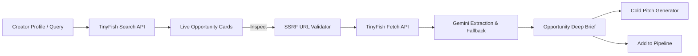

# 🚀 Creator Engine — Creator Monetisation & Brand Opportunity Engine

A modern SaaS platform designed to help digital creators grow their audience, diversify monetization streams, discover tailored brand opportunities, and execute strategic actions.

Built for hackathons, team collaboration, and scalable creator intelligence.

---

## 👥 Demo Personas Included

The platform includes two fully configured creator profiles demonstrating dynamic personalization:
1. **Rahul Sharma** (@rahulfit.india)
   - **Niche**: Fitness & Nutrition
   - **Platform**: Instagram (15,000 followers, 4.8% engagement rate)
   - **Audience**: College students & fitness beginners
   - **Goal**: Brand Collaborations & Sponsorships (Target: ₹50,000/mo)
2. **Priya Nair** (priya-nair-finance)
   - **Niche**: Personal Finance & Investing
   - **Platform**: LinkedIn (8,000 followers, 5.6% engagement rate)
   - **Audience**: Tech professionals & corporate managers
   - **Goal**: High-Ticket Consulting & Advisory Clients (Target: ₹1,20,000/mo)

---

## 🛠️ Tech Stack

- **Framework**: [Next.js](https://nextjs.org/) (App Router)
- **Language**: [TypeScript](https://www.typescriptlang.org/)
- **Live Web Intelligence**: [TinyFish](https://tinyfish.io/) (Live Web Search & Fetch API)
- **AI & Extraction**: [Google Gemini](https://ai.google.dev/) (`gemini-2.5-flash` for zero-fabrication parsing & pitch generation)
- **Styling**: [Tailwind CSS](https://tailwindcss.com/)
- **Icons**: [Lucide React](https://lucide.dev/)
- **State Management**: React Context (`CreatorContext`) with local storage persistence
- **Bundler**: Turbopack

---

## 📑 Core Pages & Modules

| Route | Page | Description |
|---|---|---|
| `/` | **Overview Dashboard** | Welcome banner, audience KPIs, roadmap progress, top actions & top matched deals. |
| `/profile` | **Creator Profile** | Editable identity, metrics, goals, completion gauge, and live shareable media kit preview. |
| `/roadmap` | **Growth Roadmap** | Phased 30/60/90-day plan with interactive milestones, content gaps, skills to build & case studies. |
| `/monetisation` | **Monetisation Engine** | 5 core revenue streams (Collabs, Consulting, Digital Products, Affiliates, Speaking) with caveats. |
| `/opportunities` | **Opportunities & Radar** | Curated brand campaigns + **Live Opportunity Radar** (real-time web search for sponsorships, ambassador calls & grants powered by TinyFish). |
| `/workflow` | **Workflow & Deal Automation** | 5-stage SOP stepper, dynamic cold pitch email generator, ASCI compliance checks & invoice templates. |
| `/actions` | **Action Centre** | Prioritized execution queue with deadlines, reasons, completion tracker, and custom action creator. |

---

## 🛰️ Creator Opportunity Radar (TinyFish Integration)

The **Creator Opportunity Radar** transforms Creator Engine from a static database into a live-web intelligence platform. Using **TinyFish's Search & Fetch APIs** combined with **Google Gemini**, creators can discover real-time brand sponsorships, ambassador calls, and creator grants across the live web.

### 🔄 End-to-End Architecture



### ⚡ Key Capabilities

1. **Live Web Opportunity Search**:
   - Queries the open web via TinyFish Search API for live brand partnership calls, creator grant announcements, and sponsorship application pages.
   - Filterable by creator niche (Fitness, Finance, Tech, Lifestyle, etc.) and geographic market.

2. **Safe Web Page Fetch & Inspection**:
   - Pulls live source webpage content via TinyFish Fetch API in clean markdown format.
   - Preserves full campaign context, eligibility requirements, and brand links.

3. **Grounded AI Extraction (Zero-Fabrication Guarantee)**:
   - Uses Gemini to extract structured campaign parameters: **Eligibility**, **Compensation / Budget**, **Application Deadline**, and **Direct Application Links**.
   - **Anti-Hallucination Guardrail**: If the source webpage does not state compensation or deadlines, the system strictly tags them as *"Unspecified"* rather than inventing numbers.
   - **Heuristic Fallback Engine**: If AI rate limits occur, a deterministic regex/pattern fallback extracts key details without crashing.

4. **Dynamic Cold Pitch & Strategy Generator**:
   - Generates personalized outreach pitch emails and tactical angle recommendations referencing the creator's follower count, engagement rate, and audience demographics.

5. **1-Click Pipeline Sync**:
   - "Add to Pipeline" maps live-web opportunities directly into the creator's local opportunity pipeline, with title normalization and deterministic ID deduplication to prevent duplicate entries.

### 🛡️ Enterprise-Grade Security & Safety

- **Comprehensive SSRF Protection (`src/lib/tinyfish/urlSafety.ts`)**:
  - Validates all target URLs before any TinyFish fetch call.
  - Blocks loopback addresses (`127.0.0.0/8`, `localhost`, `::1`), private IP subnets (`10.0.0.0/8`, `172.16.0.0/12`, `192.168.0.0/16`, `fc00::/7`), link-local IPs (`169.254.0.0/16`, `fe80::/10`), cloud metadata endpoints (AWS, GCP, Azure, DigitalOcean), single-label internal hostnames, and encoded formats (hex, octal, dword).
  - Only allows standard public `http:` and `https:` protocols on ports 80 and 443.
- **Server-Side Credential Isolation**:
  - `TINYFISH_API_KEY` and `GEMINI_API_KEY` are strictly server-side environment variables.
  - Zero exposure in client bundles, public API responses, or browser payloads.
- **Graceful Error Resilience**:
  - Transparent error handling for rate limits (429), timeouts (504), and upstream network errors with user-friendly retry banners.

### 🔌 API Endpoints

| Endpoint | Method | Description |
|---|---|---|
| `/api/opportunities/radar/search` | `POST` | Queries TinyFish for active brand campaigns and sponsorships based on niche and location. |
| `/api/opportunities/radar/extract` | `POST` | Validates URL safety, fetches live webpage content via TinyFish Fetch, and runs structured extraction. |

---

## ⚙️ GitHub Actions Workflows

Automated CI/CD pipelines in `.github/workflows/` track builds and PR quality on GitHub:

1. **`ci.yml` (CI Pipeline)**:
   - Triggers on every push and pull request to `main`.
   - Executes automated dependency checks, TypeScript type checking (`tsc --noEmit`), ESLint linting, and production builds (`next build`).
2. **`pr-check.yml` (Team PR Verification)**:
   - Automatically validates teammate contributions before merges, ensuring branch stability.

Check the live status under the **[Actions Tab](https://github.com/w-krrishgp/creator-engine/actions)** on GitHub.

---

## 💻 Getting Started for Teammates

### 1. Clone the repository
```bash
git clone https://github.com/w-krrishgp/creator-engine.git
cd creator-engine
```

### 2. Install dependencies
```bash
npm install
```

### 3. Configure environment variables
Copy `.env.example` to `.env.local` and add your API keys:
```bash
cp .env.example .env.local
```
Add your credentials:
```env
# Google Gemini API (https://aistudio.google.com/)
GEMINI_API_KEY=your_gemini_api_key

# TinyFish Live-Web API (https://agent.tinyfish.ai/api-keys)
TINYFISH_API_KEY=your_tinyfish_api_key
```

### 4. Run the development server
```bash
npm run dev
```

Open [http://localhost:3000](http://localhost:3000) in your browser.

### 5. Build for production
```bash
npm run build
```

---

## 🤝 Team Contribution Workflow

1. **Branching**:
   - Create a feature branch off `main`:
     ```bash
     git checkout -b feature/your-feature-name
     ```
2. **Committing**:
   - Write clear, concise commit messages:
     ```bash
     git commit -m "feat: add brand filter by minimum budget"
     ```
3. **Pull Requests & Automated CI**:
   - Push your branch to GitHub:
     ```bash
     git push -u origin feature/your-feature-name
     ```
   - Open a Pull Request into `main`. The automated GitHub Actions workflow will test your code.
   - Request reviews from teammates before merging.

---

## 📄 License & Notes
Created for hackathon demonstration. All brand campaigns and monetization projections are illustrative demo models.
